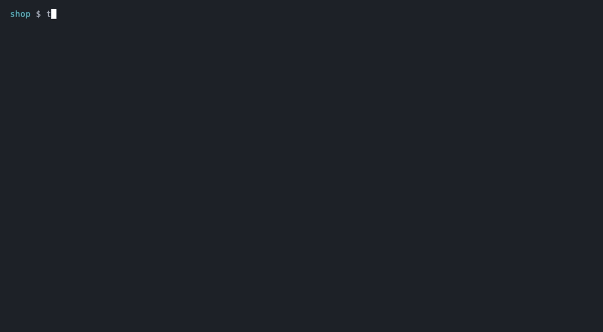
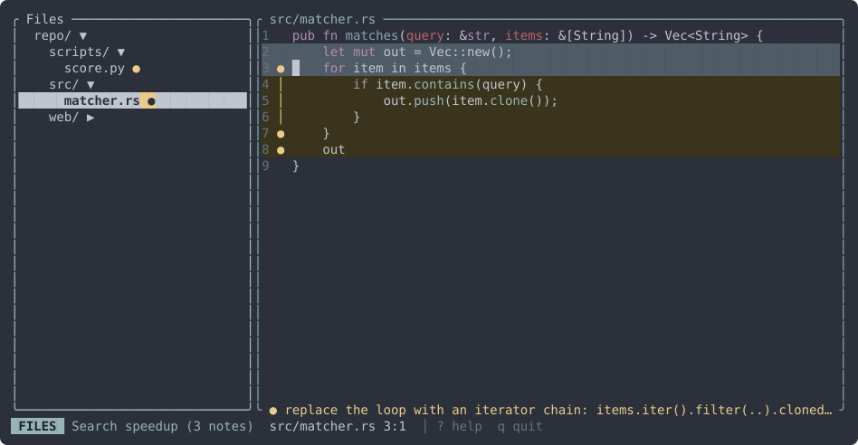
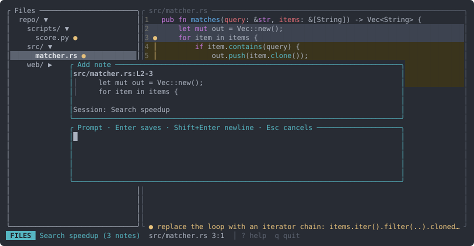
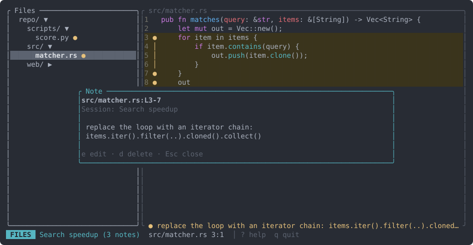
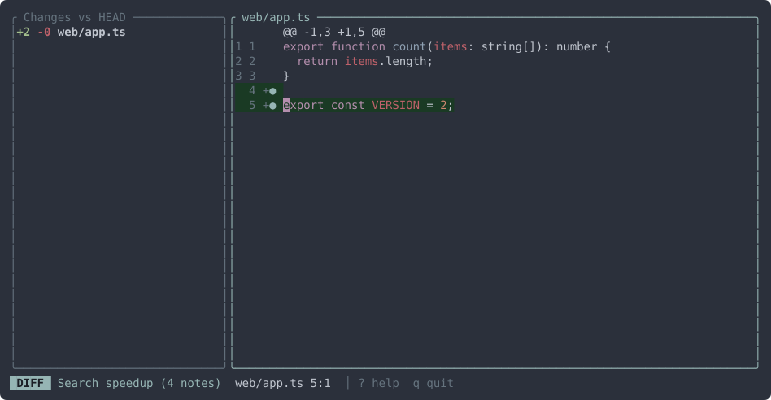
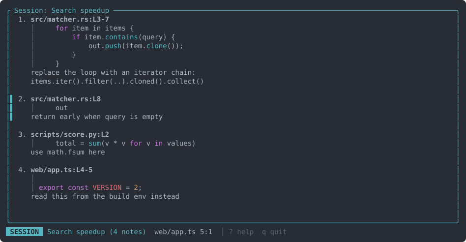
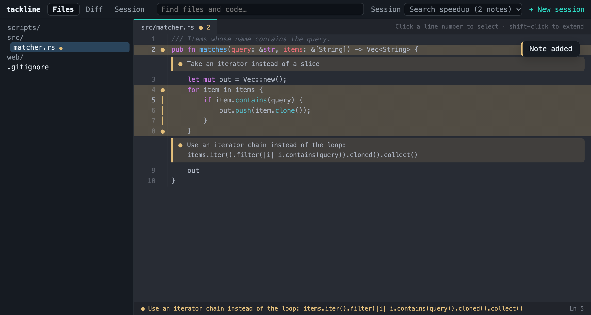

# tackline

**Point at code, write what your coding agent should do there, and hand it one
prompt.** Works with Claude Code, Codex, opencode, aider, Cursor, or anything
else that takes a prompt.



[Docs](https://terminalkitten.github.io/tackline/) ·
[crates.io](https://crates.io/crates/tackline) ·
[GitHub](https://github.com/terminalkitten/tackline)

## Install

One command, no Rust needed:

```sh
# macOS and Linux
curl --proto '=https' --tlsv1.2 -LsSf https://github.com/terminalkitten/tackline/releases/latest/download/tackline-installer.sh | sh

# Homebrew
brew install terminalkitten/tap/tackline

# Windows (PowerShell)
powershell -ExecutionPolicy Bypass -c "irm https://github.com/terminalkitten/tackline/releases/latest/download/tackline-installer.ps1 | iex"

# With Rust
cargo install tackline
```

This installs two commands that do the same thing: `tackline` and the shorter
`tack`. Prebuilt binaries for macOS, Linux and Windows are on the
[releases page](https://github.com/terminalkitten/tackline/releases). See the
[install guide](https://terminalkitten.github.io/tackline/getting-started/)
for more.

## What it does

> A tackline is the short length of line on a signal halyard that separates
> the flags. This tool hangs signals on lines of code for an agent to read.

Browse your files or the git diff, select a line or a block of code, and
attach an instruction to it. Notes are grouped into named sessions, and a
session compiles into one Markdown prompt, each note with its file, lines and
code. That's agent steering, not code review: notes are instructions for an
agent, not verdicts on the code.

1. Run `tackline` (or `tack`) in a repository. It opens on the Diff view if you
   have uncommitted changes, otherwise on the Files view.
2. Select code with `V` (lines), `v` (characters), Shift+arrows or a mouse
   drag, and press `c`. Write the instruction and press `Enter`.
   The first time, you name a session.
3. Press `3` to review the session: every note with its location, code and
   instruction, in prompt order (`J`/`K` reorder).
4. Press `y` to copy the prompt and paste it into your agent, or hand it over
   from the shell.

Prefer clicking? `tackline serve` opens the same tool
[in your browser](#in-the-browser).

## Use it with your agent

The prompt is plain Markdown, so any agent that takes a prompt can use it:

| Agent | Hand over the prompt |
|---|---|
| Claude Code | `tackline export \| claude -p` |
| Codex | `codex exec "$(tackline export)"` |
| opencode | `opencode run "$(tackline export)"` |
| aider | `aider --message "$(tackline export)"` |
| Cursor | paste it into the chat (`y` copies), or `agent -p "$(tackline export)"` |
| Anything else | `y` copies it; `tackline export > prompt.md` saves it |

**Claude Code extra:** a skill turns your notes into a slash command. Save this
as `.claude/skills/tackline/SKILL.md` and run `/tackline` in Claude Code:

```markdown
---
name: tackline
description: Work through the notes in my active tackline session
allowed-tools: Bash(tackline *)
---

## My notes on the code

!`tackline export`

## Your task

Work through these notes in order. Each one names a file, the lines, the code
as it is now, and what to do there.
```

The compiled prompt looks like this:

````markdown
# Search speedup

1. `src/matcher.rs:3-7`
   ```rs
       for item in items {
           if item.contains(query) {
               out.push(item.clone());
           }
       }
   ```
   replace the loop with an iterator chain
````



Noted ("tacked") code is easy to spot: it's tinted light yellow, with `●`/`│`
markers in the gutter, and the bottom border of the code pane shows the start
of the note under the cursor. Press `Enter` there to read the whole note.

Notes follow the code: when lines are inserted above a note or the code moves
within the file, the note moves with it. If the annotated code is gone, the
note is marked stale (`⚠`) and left out of the prompt with a warning.

## Views

| | |
|---|---|
|  |  |
| **Note popup**: location, code and target session (`Tab` cycles). | **Note viewer**: `Enter` on a noted line shows the whole note. |
|  |  |
| **Diff view**: notes attach to new-side lines. | **Session view**: the prompt, note by note, in order. |

## In the browser

```sh
tackline serve
```

The same tool in your browser, for people who'd rather click than learn keys: open files, select
lines, write notes, copy the prompt. It runs on `127.0.0.1` only and works on the same files as
the terminal app. A small JSON API comes with it. See the
[Web version guide](docs/site/guides/web.md).



## Keys

Everything is Ctrl or plain keys: macOS terminals don't pass Cmd shortcuts on
to terminal apps. Press `?` in the app for the full list.

| Key | Action |
|---|---|
| `1` / `2` / `3` | Files / Diff / Session view |
| `Ctrl+N` / `Ctrl+O` | New session / pick the active session |
| `Shift+Tab` | Switch to the next session |
| `Ctrl+P` / `Ctrl+F` | Find a file / search code in the repo |
| `Tab` | Switch between the list and the code |
| `j` `k` `h` `l`, arrows, `gg` `G`, `Ctrl+D` `Ctrl+U`, `0` `$` | Move |
| `/` then `n` / `N` | Search this file |
| `:<n>` | Go to line |
| `w` | Wrap long lines |
| `v` / `V` / Shift+arrows / drag | Select characters / lines |
| `c` | Note the selection (or the line); on a noted line, edit that note |
| `d` | Delete the note on this line (asks first) |
| `Enter` | Show the whole note on this line |
| `r` | Reload the diff |
| `y` (Session view) | Copy the compiled prompt |
| `e` / `d` / `J` `K` (Session view) | Edit / delete / reorder notes |
| `q` | Quit (everything is saved as you go) |
| Mouse | Click the tree to open files, click or drag in the code, scroll with the wheel |

In the note popup, `Enter` saves. For a newline, type `\` and press `Enter`,
or use `Shift+Enter` in terminals that report it (Ghostty, Kitty, WezTerm,
Alacritty, iTerm2 with "Report keys using CSI u").

## CLI

```
tackline [--base <rev>] [--theme <name>]
    Open the app. --base diffs against merge-base(HEAD, <rev>), e.g.
    --base upstream/main for a fork. --theme picks a syntax theme
    (default: base16-ocean.dark, or InspiredGitHub on light terminals;
    every theme is shown in the docs' Themes page).

tackline export [<session>]
    Print the compiled prompt (default: the active session).
    Warnings go to stderr.

tackline sessions
    List sessions with note counts; * marks the active one.
```

## Data

Sessions live in `.tackline/sessions/<name>.json` in the repo root, one
readable JSON file per session; `.tackline/state.json` remembers the active
session and the last file. Every change is saved immediately (atomic writes).
On first run tackline offers to add `.tackline/` to `.gitignore`.

## Terminal notes

- **Mouse**: tackline captures the mouse for clicks, drags and the wheel. To
  select terminal text instead, hold Option (iTerm2, Terminal.app) or Shift
  (most others) while dragging.
- **Clipboard over ssh / tmux**: `y` copies with OSC 52, so the prompt lands
  in your local clipboard. In tmux, enable `set -g set-clipboard on`.
- **Speed**: rendering is done by your terminal; GPU-accelerated terminals
  (Ghostty, WezTerm, Kitty, Alacritty, iTerm2) scroll smoothest.

## Development

```sh
cargo fmt --check
cargo clippy --all-targets -- -D warnings
cargo test
cargo test screenshots -- --ignored   # redraw docs/site/img/*.svg
cargo test theme_gallery -- --ignored # redraw the theme gallery and its docs page
```

### Releasing

Bump `version` in `Cargo.toml`, commit, then tag and push:

```sh
git tag -s v0.1.2 -m "tackline 0.1.2"
git push origin main v0.1.2
```

The tag starts `.github/workflows/release.yml`: it checks that the tag matches
`Cargo.toml` and runs the tests, publishes to crates.io (trusted publishing,
no stored token) and opens a draft GitHub release with the changes since the
previous tag. Preview those notes locally with `scripts/release-notes.sh v0.1.2`.

The usage docs are in [`docs/site/`](docs/site/index.md), built with
[dokk](https://github.com/terminalkitten/dokk):

```sh
dokk serve --root docs   # live preview
dokk build --root docs   # static site in docs/.dokk/build
``` Built on
[tui-realm](https://github.com/veeso/tui-realm), syntect with two-face, git2,
nucleo and ripgrep's libraries.
