<!-- Generated by `cargo test theme_gallery -- --ignored`; edit the generator, not this file. -->

tackline highlights code with one of these themes. Without `--theme` it picks `base16-ocean.dark`, or
`InspiredGitHub` when the terminal reports a light background (see [Terminals](terminals.md#light-and-dark)).

```sh
tackline --theme "TwoDark"
```

`ansi`, `base16` and `base16-256` use your terminal's own colors, so they follow your terminal's
color scheme; the screenshots show them with a One Dark palette. Borders, the status bar and the
note markers always use your terminal's colors.

## Dark

| **ansi** | **base16** |
| --- | --- |
| [](../img/themes/ansi.svg) | [](../img/themes/base16.svg) |
| `--theme "ansi"` | `--theme "base16"` |

| **base16-eighties.dark** | **base16-mocha.dark** |
| --- | --- |
| [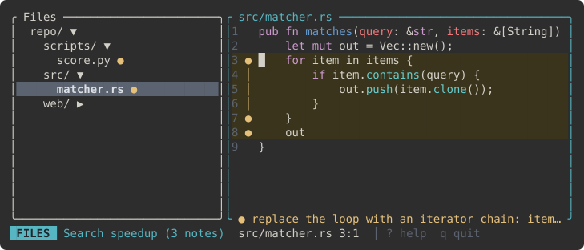](../img/themes/base16-eighties-dark.svg) | [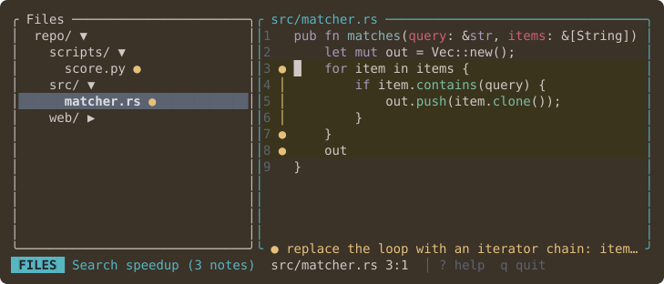](../img/themes/base16-mocha-dark.svg) |
| `--theme "base16-eighties.dark"` | `--theme "base16-mocha.dark"` |

| **base16-ocean.dark** | **base16-256** |
| --- | --- |
| [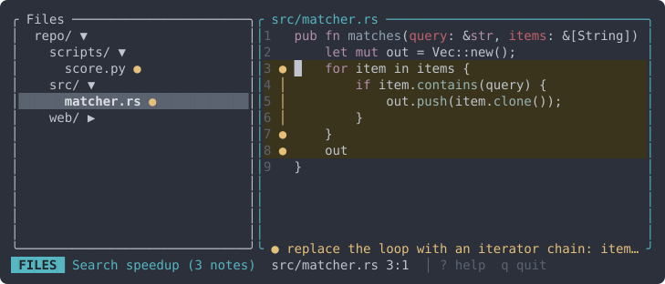](../img/themes/base16-ocean-dark.svg) | [](../img/themes/base16-256.svg) |
| `--theme "base16-ocean.dark"` | `--theme "base16-256"` |

| **Catppuccin Frappe** | **Catppuccin Macchiato** |
| --- | --- |
| [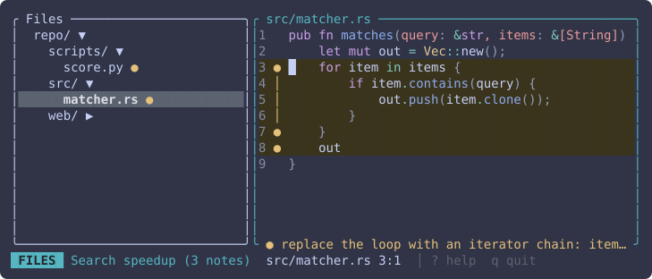](../img/themes/catppuccin-frappe.svg) | [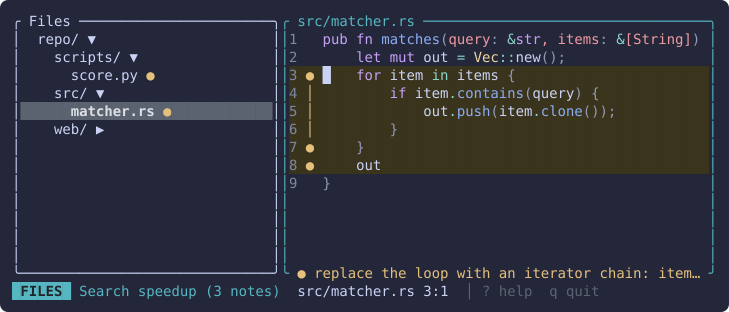](../img/themes/catppuccin-macchiato.svg) |
| `--theme "Catppuccin Frappe"` | `--theme "Catppuccin Macchiato"` |

| **Catppuccin Mocha** | **Coldark-Dark** |
| --- | --- |
| [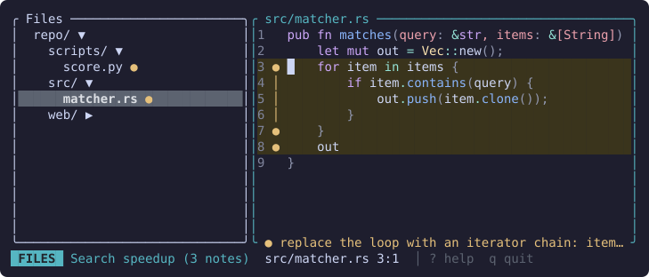](../img/themes/catppuccin-mocha.svg) | [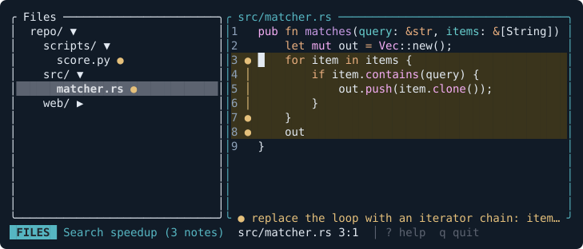](../img/themes/coldark-dark.svg) |
| `--theme "Catppuccin Mocha"` | `--theme "Coldark-Dark"` |

| **DarkNeon** | **Dracula** |
| --- | --- |
| [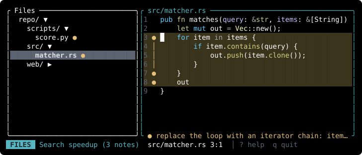](../img/themes/darkneon.svg) | [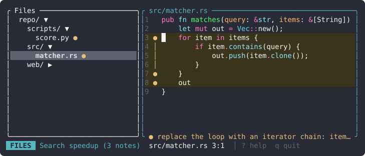](../img/themes/dracula.svg) |
| `--theme "DarkNeon"` | `--theme "Dracula"` |

| **gruvbox-dark** | **1337** |
| --- | --- |
| [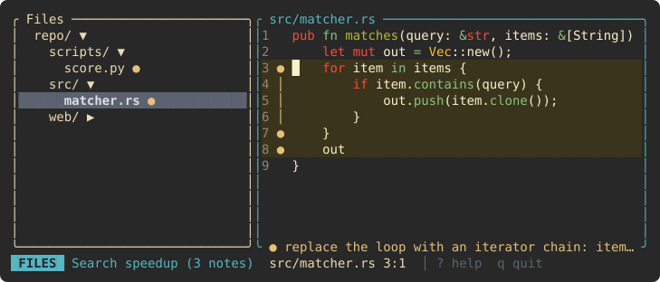](../img/themes/gruvbox-dark.svg) | [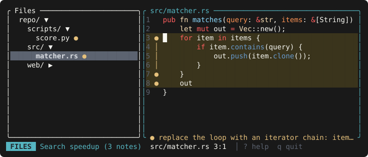](../img/themes/1337.svg) |
| `--theme "gruvbox-dark"` | `--theme "1337"` |

| **Monokai Extended** | **Monokai Extended Bright** |
| --- | --- |
| [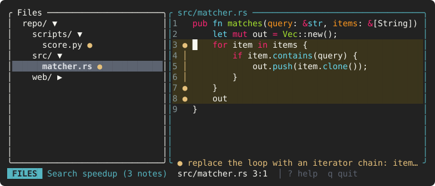](../img/themes/monokai-extended.svg) | [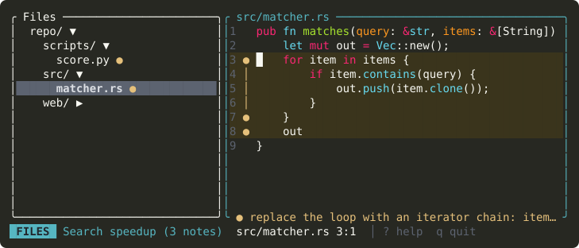](../img/themes/monokai-extended-bright.svg) |
| `--theme "Monokai Extended"` | `--theme "Monokai Extended Bright"` |

| **Monokai Extended Origin** | **Nord** |
| --- | --- |
| [](../img/themes/monokai-extended-origin.svg) | [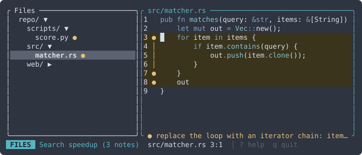](../img/themes/nord.svg) |
| `--theme "Monokai Extended Origin"` | `--theme "Nord"` |

| **OneHalfDark** | **Solarized (dark)** |
| --- | --- |
| [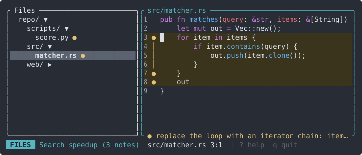](../img/themes/onehalfdark.svg) | [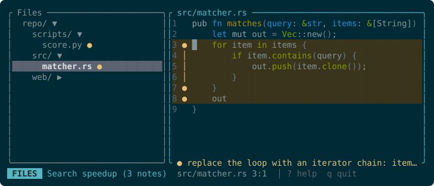](../img/themes/solarized-dark.svg) |
| `--theme "OneHalfDark"` | `--theme "Solarized (dark)"` |

| **Sublime Snazzy** | **TwoDark** |
| --- | --- |
| [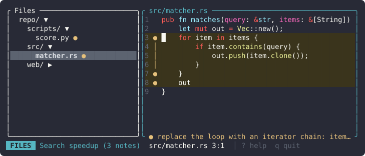](../img/themes/sublime-snazzy.svg) | [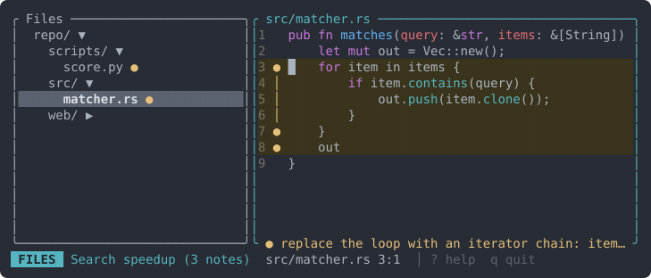](../img/themes/twodark.svg) |
| `--theme "Sublime Snazzy"` | `--theme "TwoDark"` |

| **zenburn** |  |
| --- | --- |
| [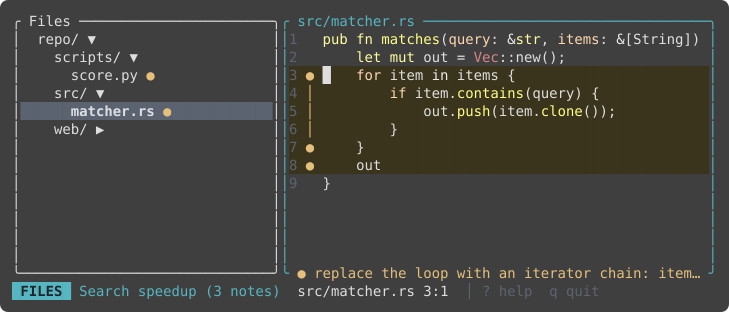](../img/themes/zenburn.svg) |  |
| `--theme "zenburn"` |  |

## Light

| **base16-ocean.light** | **Catppuccin Latte** |
| --- | --- |
| [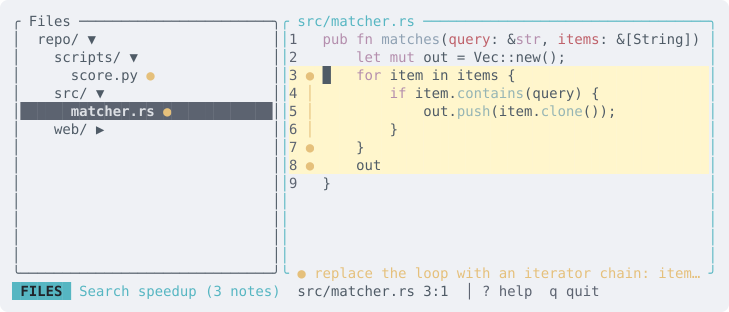](../img/themes/base16-ocean-light.svg) | [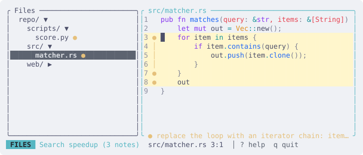](../img/themes/catppuccin-latte.svg) |
| `--theme "base16-ocean.light"` | `--theme "Catppuccin Latte"` |

| **Coldark-Cold** | **GitHub** |
| --- | --- |
| [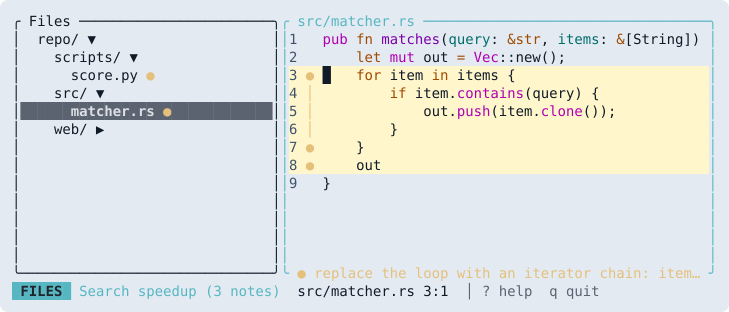](../img/themes/coldark-cold.svg) | [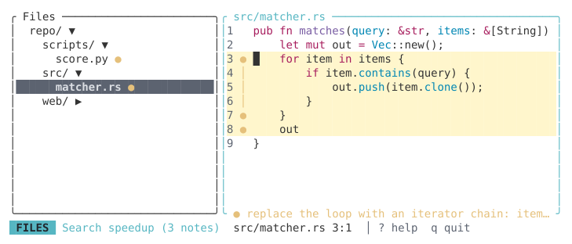](../img/themes/github.svg) |
| `--theme "Coldark-Cold"` | `--theme "GitHub"` |

| **gruvbox-light** | **InspiredGitHub** |
| --- | --- |
| [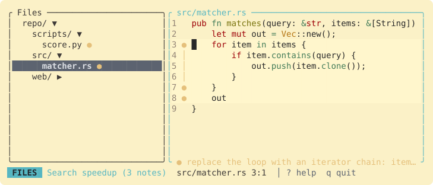](../img/themes/gruvbox-light.svg) | [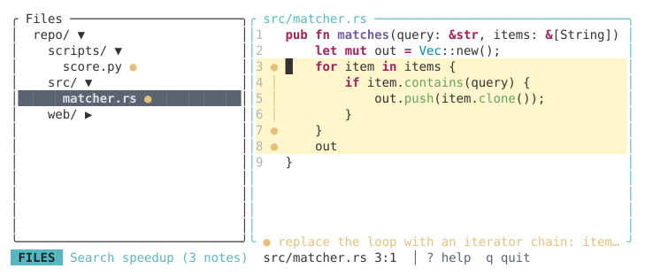](../img/themes/inspiredgithub.svg) |
| `--theme "gruvbox-light"` | `--theme "InspiredGitHub"` |

| **Monokai Extended Light** | **OneHalfLight** |
| --- | --- |
| [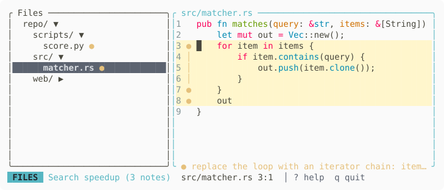](../img/themes/monokai-extended-light.svg) | [](../img/themes/onehalflight.svg) |
| `--theme "Monokai Extended Light"` | `--theme "OneHalfLight"` |

| **Solarized (light)** |  |
| --- | --- |
| [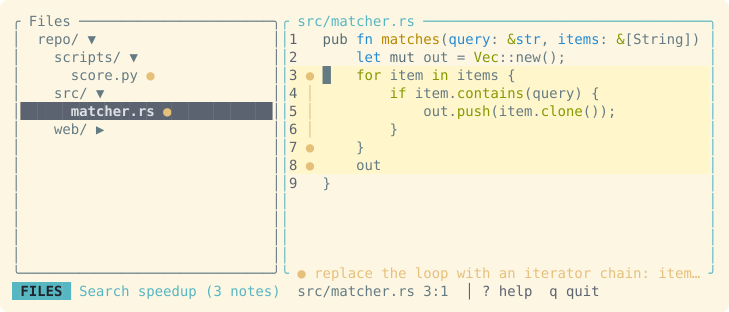](../img/themes/solarized-light.svg) |  |
| `--theme "Solarized (light)"` |  |

